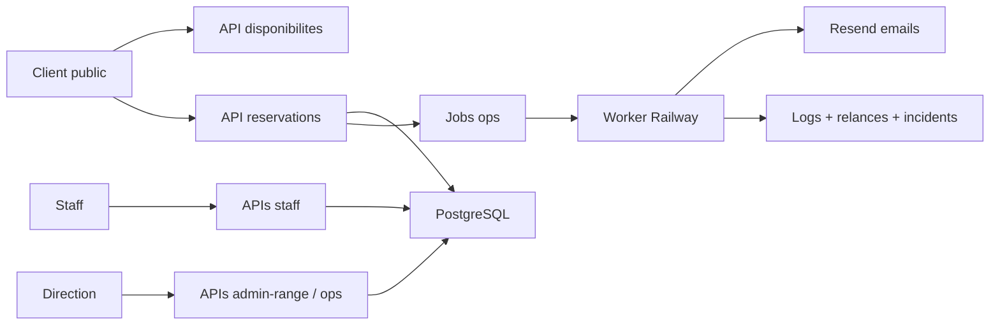

# Architecture technique

## Vue d'ensemble

Pinlane est actuellement un projet web leger avec:

- pages HTML publiques et back-office;
- assets JS/CSS;
- APIs serverless Vercel;
- base PostgreSQL;
- worker Railway pour les traitements en fond;
- Resend pour les emails.

## Fichiers d'entree

- App publique: `index.html`, `public-form.html`, `pro.html`
- Direction: `direction.html`
- UI staff/admin: `assets/`
- APIs: `api/`
- Metier: `lib/`
- Base: `database/`
- Worker: `workers/ops-worker.js`
- Connaissance operationnelle: `ops-knowledge/`

## Flux general

## Source de verite

La source de verite doit rester la base PostgreSQL.

Le navigateur ne doit pas decider seul:

- capacite;
- pistes;
- sessions laser;
- paiement;
- statut;
- retards;
- relances.

## Railway

Railway porte le worker continu.

Ce worker traite:

- communications;
- jobs;
- agents;
- relances;
- suivi no-show;
- follow-up.

## Vercel

Vercel porte:

- site public;
- APIs serverless;
- domaine;
- fallback cron.

Important: les deploys GitHub/Vercel peuvent etre bloques par reglage compte. Le deploy direct CLI a fonctionne.

