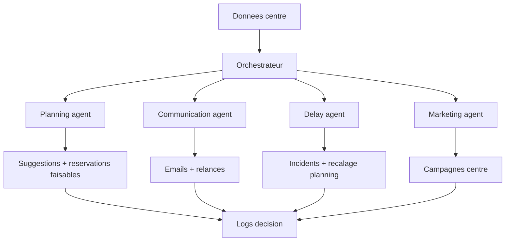

# Ecosysteme agents

## Principe

Les agents ne doivent pas etre du theatre.

Chaque agent doit:

- lire des donnees reelles;
- produire une decision traçable;
- ecrire un log;
- proposer une action;
- ne jamais inventer une disponibilite.

## Agents actuels

- orchestrateur;
- planning agent;
- communication agent;
- delay agent;
- field pilot agent;
- marketing agent;
- research agent;
- QA/redteam agent;
- security agent;
- design agent.

## Cycle attendu

## Regles de securite

- Pas d'action externe sans garde-fou.
- Pas de mail envoye si donnees client invalides.
- Pas de reservation confirmee si capacite non tenue.
- Pas d'invention d'activite ou de formule.
- Les agents doivent citer leur source de donnees interne.

## Ce qui est vraiment connecte

- Worker Railway en continu.
- Jobs en base.
- Emails Resend.
- Logs worker.
- Simulations et tests.

## Ce qui reste a connecter pour une IA serveur complete

Une vraie cle API ou un gateway IA serveur.

L'abonnement ChatGPT Pro ne peut pas etre utilise directement par un worker Railway 24/7.

